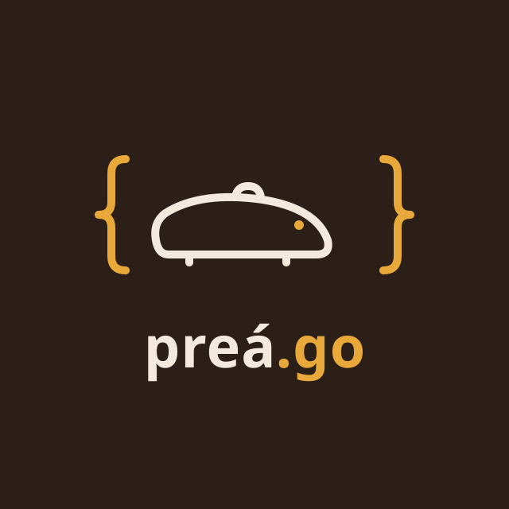

<p align="center">
  
</p>

<p align="center">
  A modular web framework for Go.<br>
  <a href="https://prea-framework.github.io/prea/"><strong>Documentation</strong></a> ·
  <a href="https://prea-framework.github.io/prea/tutorial/">Tutorial</a> ·
  <a href="https://prea-framework.github.io/prea/reference/cli">CLI reference</a>
</p>

<p align="center">
  <a href="https://github.com/prea-framework/prea/actions/workflows/ci.yml"></a>
  <a href="https://pkg.go.dev/github.com/prea-framework/prea"></a>
  <a href="https://goreportcard.com/report/github.com/prea-framework/prea"></a>
  <a href="LICENSE"></a>
</p>

---

Preá splits an application into **preás**: small modules, one per feature, each with its own handler, service, repository and model. You declare the pieces, and Preá wires them together, checks the wiring when the app starts and serves them over HTTP.

```go
var Module = &core.Module{
	Name: "task",
	Providers: []any{
		Repository{},
		Service{},
		Handler{},
	},
}

type Service struct {
	Repo *Repository `inject:""` // filled in when the app starts
}
```

> **Status:** pre-alpha (`v0.0.x`). The API still changes between versions.

## Highlights

- **Preás and components.** Group a feature in one folder and ask for what you need with `inject:""`. A missing or ambiguous dependency stops the app at startup, never in production.
- **Configuration with profiles.** `config/application.yaml` plus one file per profile (`dev`, `prod`, `tests`), with secrets from the environment.
- **Database from your models.** Struct tags describe the schema. Preá generates migrations from them, applies them and gives every model a ready-made repository.
- **A CLI for the whole cycle.** Create, generate, run with hot reload, test, migrate and build.

## Quick start

You need Go 1.26 or newer, and PostgreSQL if your app uses a database.

```bash
# Install the CLI
curl -fsSL https://raw.githubusercontent.com/prea-framework/prea/main/install.sh | sh

# Create a project with a database and run it with hot reload
prea new todo --with-db
cd todo
cp .env.example .env    # set DATABASE_URL and TEST_DATABASE_URL
prea dev
```

```bash
curl localhost:8000/health
curl -X POST localhost:8000/item -H 'Content-Type: application/json' -d '{"name": "first"}'
```

The [Quick start](https://prea-framework.github.io/prea/guide/quick-start) explains each step, and the [tutorial](https://prea-framework.github.io/prea/tutorial/) builds a complete todo API.

## Modules

Preá is a set of Go modules. A project created by `prea new` depends on the root one, which brings the others.

| Module | What it has |
|---|---|
| [`github.com/prea-framework/prea`](https://pkg.go.dev/github.com/prea-framework/prea) | `prea.Run` and `prea.Test`: start or test an app from its configuration |
| [`.../core`](https://pkg.go.dev/github.com/prea-framework/prea/core) | preás, the HTTP server, middlewares, HTTP security, errors and responses |
| [`.../di`](https://pkg.go.dev/github.com/prea-framework/prea/di) | the dependency injection container |
| [`.../database`](https://pkg.go.dev/github.com/prea-framework/prea/database) | repositories, queries, transactions, schema and migrations (PostgreSQL) |
| [`.../config`](https://pkg.go.dev/github.com/prea-framework/prea/config) | configuration files, profiles and `.env` |
| [`.../security`](https://pkg.go.dev/github.com/prea-framework/prea/security) | JWT and password hashing |
| [`.../logger`](https://pkg.go.dev/github.com/prea-framework/prea/logger) | leveled, structured logs |
| [`.../cmd/prea`](https://pkg.go.dev/github.com/prea-framework/prea/cmd/prea) | the `prea` CLI |

## Contributing

Preá is young, and the [contributing guide](https://prea-framework.github.io/prea/about/contributing) explains how to run the tests and send a change.

## The name

A preá is a small rodent from the Brazilian Northeast, where Preá was born. [Meet the preá](https://prea-framework.github.io/prea/about/the-name).

## License

[MIT](LICENSE)
